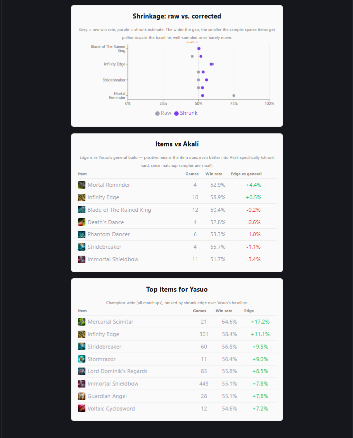
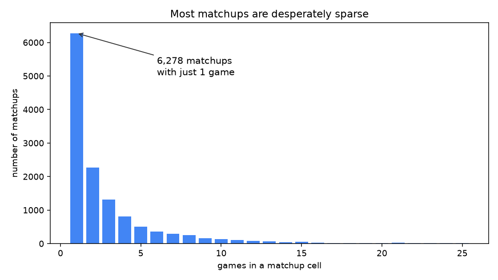
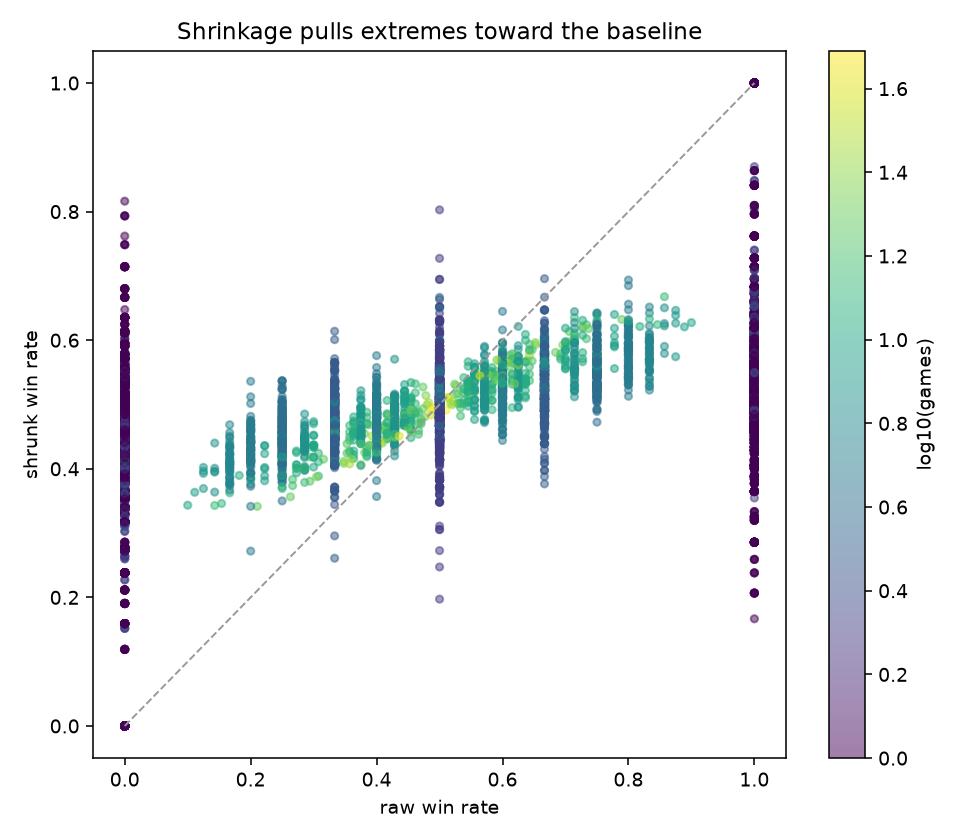
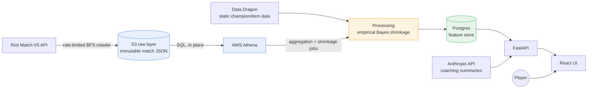

# LoL Matchup Analytics

**Personalized League of Legends matchup analytics, powered by hierarchical Bayesian shrinkage.**

Most stat trackers report raw win rates on tiny samples, i.e., a "100% win rate" that's really 1 game. This tool builds population-level baselines from a corpus of ranked matches, then corrects individual matchup estimates toward those baselines using empirical-Bayes shrinkage, weighted by how much data actually backs each number. Every figure the tool shows comes with its sample size and a confidence label, because an honest estimate that says "we don't know yet" beats a confident lie.

> The core question this answers that op.gg can't: **"Do *I* actually beat the field in this matchup, and how sure can we be?"**




---

## Population data vs. your data

The tool draws on two distinct layers, and every panel in the UI is labeled by which one it uses:

| Panel | Data source | What it answers |
|-------|-------------|-----------------|
| **Matchup win rate** (top card, with confidence badge) | **Population** — the full corpus of crawled ranked matches | How this champion-vs-champion matchup goes *across all players*, shrunk for sample size |
| **Your history** (personal-vs-population card) | **Personal** — only matches containing the tracked player's PUUID | How *you specifically* perform in this matchup, and whether you beat the population baseline |
| **Top items for [champion]** | **Population** | Champion-wide item win rates across all players, ranked by shrunk edge |
| **Items vs [opponent]** | **Population** | Item win rates for this champion *into this specific opponent*, across all players |
| **Shrinkage chart** | **Population** | Raw vs. corrected item win rates, visualizing the shrinkage |
| **AI coaching summary** | **Both** | A plain-language summary that combines your personal edge with population item trends, flagging small samples |

The design principle is that **population data provides the priors and personal data is the signal being estimated**. Your personal history is small and noisy on its own — the population layer is what makes an honest personalized estimate possible. The "Your history" card is the only place your own games directly drive the numbers; everything else is population-wide context, and the AI summary is the one place the two are woven together.


---

## Why this is different

A player's personal history is *small data*. Over six games against a champion, a 4–2 record is statistically meaningless, essentially indistinguishable from a coin flip. Existing trackers report that 4–2 as "67%."

This project treats each sparse estimate as a **Bayesian update** on a population prior:

- Build champion-vs-champion matchup baselines from a large corpus of ranked matches.
- For any specific (and usually sparse) matchup, shrink the raw win rate toward that baseline, weighted by sample size. A 1-game "100%" collapses to the baseline; a 40-game rate barely moves.
- Apply the correction **hierarchically**: a player's personal cells shrink toward the *already-shrunk* population estimate, which itself shrinks toward the champion's overall lane rate. Priors shrink toward priors — the correct treatment for a long-tailed matchup space.

The shrinkage is validated with an out-of-sample backtest, not just asserted (see [The statistics](#the-statistics)).

---

## The statistics

The whole idea in one line: a win rate from a handful of games is mostly noise, so we pull it toward a trustworthy average, and we pull harder when we have less data.

### The problem

The obvious way to rate a matchup is wins divided by games. Call it $\hat{p} = w/n$. The trouble is how much that number bounces around when $n$ is small:

$$\mathrm{Var}(\hat{p}) = \frac{p(1-p)}{n}.$$

As $n$ shrinks, the variance blows up. At a single game the estimate is always exactly 0 or 1, maximally confident and completely useless. And most of the data looks like this. The vast majority of matchups have only one or two games behind them:



The same story from another angle. At low game counts the win rate is scattered everywhere, and it only settles down as games pile up:


That fan of noise on the left is exactly what the method fixes.

### The fix: shrinkage

Treat each matchup's wins as a Binomial draw, $w \sim \mathrm{Binomial}(n, p)$, and put a Beta prior on the true win rate $p$, centered on a baseline $\mu$ we already trust (the champion's overall rate in that lane):

$$p \sim \mathrm{Beta}(\alpha, \beta), \qquad \alpha = k\mu, \qquad \beta = k(1-\mu).$$

Here $\mu$ is where the prior is centered and $k$ is how strongly we believe it, measured in "pretend games." Because the Beta and Binomial fit together neatly, the updated (posterior) distribution is just another Beta:

$$p \mid w \sim \mathrm{Beta}(w + \alpha,\ n - w + \beta),$$

and its mean, which is the corrected win rate, turns out to be a simple weighted average of the data and the baseline:

$$\hat{p}_{\text{shrunk}} = \frac{w + k\mu}{n + k} = \frac{n}{n+k}\hat{p} + \frac{k}{n+k}\mu.$$

Read the two weights and the behavior is obvious. When you have lots of games, $n$ dominates, the weight lands on your actual win rate, and the estimate barely moves. When you have almost no games, $k$ dominates, the weight lands on the baseline, and the noisy number gets pulled home. There is no hard cutoff anywhere, and the transition is smooth as games accumulate.



Points off the diagonal are the ones shrinkage moved. The matchups with barely any games (dark) get yanked toward the baseline, while the ones with plenty of games (bright) sit on the line, barely touched. That is the entire method in one picture.

### Picking how strong the prior should be

The one real choice is $k$. Rather than guess it, we read it off the data, which is what makes this *empirical* Bayes rather than plain Bayes. Look at the matchups that actually have enough games to trust, see how spread out their win rates are, match that spread to the Beta, and solve:

$$\hat{k} = \frac{\bar{p}(1-\bar{p})}{s^2} - 1.$$

The intuition: if real matchups all sit close to the baseline (small spread), then extreme results are almost certainly luck, so the prior should be strong and $k$ large. If real matchups genuinely differ a lot (wide spread), the prior should be weaker.

### Priors leaning on priors

The baselines are themselves shrunk, which is what makes the whole thing hierarchical. Your personal win rate in a matchup leans on the population's (already corrected) win rate for that matchup, which leans on the champion's overall rate in the lane, which leans on a coin flip:

$$\hat{p}_{\text{personal}} \leftarrow \hat{p}_{\text{population}} \leftarrow \mu_{\text{lane}} \leftarrow 0.5.$$

Why this matters: if your personal matchup has three games and you lean it on a population cell that also has three games, you have just propped one noisy number against another. Leaning on the *corrected* population number instead gives it something solid underneath. In practice this visibly changed the personal estimates.

### Does it actually work?

Shrinkage is only worth anything if it predicts better on games it has not seen. So split the games into two halves, fit both estimators on the first half, and score them on the second half using log loss:

$$\text{log loss} = -\frac{1}{N}\sum_i \left[ y_i \log \hat{p}_i + (1-y_i)\log(1-\hat{p}_i) \right].$$

| Estimator | Out of sample log loss (lower is better) |
|-----------|------------------------------------------|
| Raw win rate | **3.68** |
| Bayesian shrunk | **0.69** |

Log loss comes down hard on being confidently wrong, which is exactly the raw estimator's failure mode: it calls a matchup 0% or 100% off a game or two, then reality disagrees in the test half. The shrunk estimator never claims more certainty than the data supports, so it lands right near the honest floor of $-\ln(0.5) \approx 0.693$, the score you get by sensibly saying "close to a coin flip" when you do not know.

**Corpus:** roughly 3,100 ranked matches, giving 11,668 matchup cells (one champion against another in a given lane) and 626 baselines (one per champion and lane), plus a personal layer of over 500 matches.

---

## Architecture



**How it fits together, step by step:**

1. **Collect the data.** A crawler pulls ranked matches from Riot's API. Because Riot enforces strict rate limits, it throttles itself and walks outward from one player to their opponents, then their opponents, and so on, snowballing a large, varied corpus. Every raw match lands in S3 untouched, so the original data is never lost or overwritten.

2. **Crunch it with SQL.** Instead of loading all that JSON into a database, Athena runs SQL directly on the files in S3. This is where the raw matches become useful numbers: champion-vs-champion win rates, item outcomes, and per-lane baselines.

3. **Correct the noise and store it.** The processing step applies the Bayesian shrinkage, the core of the project, which is to turn noisy small-sample win rates into honest estimates, then saves the finished numbers into Postgres. Postgres is the "answer key" the app reads from.

4. **Serve it fast.** A FastAPI backend reads those pre-computed answers from Postgres and hands them to the React frontend. Nothing is calculated live or re-fetched from Riot on each request, so the app stays snappy.

5. **Explain it in plain English.** Optionally, the app sends the computed numbers to Claude, which writes a short coaching summary. Claude only ever sees the real statistics — it rephrases them, it doesn't invent anything, where it's told to flag when a number is based on too few games to trust.

In short: **raw matches in S3 → SQL analytics in Athena → shrinkage → a Postgres feature store → a fast API and UI**, with an optional AI layer that translates the stats into advice.

---

## The pipeline

| Stage | What it does | Key engineering |
|-------|--------------|-----------------|
| **Ingestion** | Crawls ranked matches into an immutable S3 raw layer | Dual sliding-window rate limiter (20/s + 100/2min), 429 backoff, resumable dedup, breadth-first player-graph crawl |
| **Storage** | Raw match JSON, never mutated or re-fetched | S3 with a least-privilege IAM key (no delete permission, enforcing immutability) |
| **Analytics** | SQL over raw JSON, in place | AWS Athena with a minimal nested-JSON schema (`UNNEST` over the participants array; self-join for the matchup matrix) |
| **Feature store** | Matchup matrix, champion/lane baselines, item stats, matchup-specific items, personal record | Re-runnable Athena → Postgres load jobs with upsert semantics |
| **Modeling** | Empirical-Bayes Beta-Binomial shrinkage | Prior strength estimated from data (method of moments); hierarchical (personal → population → baseline) |
| **Serving** | Calibrated estimates over HTTP | FastAPI reading the precomputed store; endpoints for matchup, personal edge, items, matchup items, champion list, and AI explanation |
| **UI** | Matchup tool foregrounding confidence | React (Vite); sample size + confidence badges, item icons, a raw-vs-shrunk chart (Recharts), and grounded AI coaching summaries |

---

## Tech stack

**Data & cloud:** AWS S3, AWS Athena, Riot Games API (production key), Data Dragon

**Backend:** Python, FastAPI, PostgreSQL, boto3, httpx, psycopg

**Modeling:** empirical-Bayes Beta-Binomial shrinkage (pandas, numpy, scipy)

**AI:** Anthropic API (Claude) for grounded natural-language coaching summaries

**Frontend:** React, Vite, Recharts

**Infra:** Docker, Docker Compose, nginx, uv workspace (monorepo)

---

## Running locally

**Prerequisites:** Docker Desktop, [uv](https://docs.astral.sh/uv/), Node.js, an AWS account, a Riot API key, and (optional, for coaching summaries) an Anthropic API key.

```bash
# 1. Clone and configure
git clone https://github.com/lyonstran/lol-matchup-analytics.git
cd lol-matchup-analytics
cp .env.example .env          # fill in RIOT_API_KEY, AWS creds, S3_BUCKET, ANTHROPIC_API_KEY, etc.

# 2. Start Postgres
docker compose up -d db

# 3. Build the corpus (rate-limited; runs in the background)
uv run --package ingest crawl

# 4. Materialize the feature store
uv run python services/common/scripts/load_features.py        # matchup + baseline stats
uv run python services/common/scripts/load_items.py           # champion-wide item stats
uv run python services/common/scripts/load_matchup_items.py   # matchup-specific item stats
uv run python services/common/scripts/load_personal.py        # personal layer

# 5. Serve
uv run --package api serve                                    # API on :8000
cd web && npm install && npm run dev                          # UI on :5173
```

*(Athena tables over the S3 raw layer are defined in `infra/athena/`; the Postgres schema is in `infra/sql/schema.sql`. EDA figures are regenerated with `uv run python notebooks/generate_figures.py`.)*

---

## Project structure

```
lol-matchup-analytics/
├── services/
│   ├── common/     # shared: Riot client, rate limiter, S3/Athena/DB helpers, Data Dragon
│   ├── ingest/     # rate-limited crawler → S3
│   └── api/        # FastAPI serving layer
├── web/            # React (Vite) frontend
├── infra/
│   ├── athena/     # Athena table DDL
│   └── sql/        # Postgres feature-store schema
├── notebooks/      # shrinkage prototyping, validation backtest, EDA figures
├── docs/figures/   # committed EDA figures used in this README
└── docker-compose.yml
```

---

## Author

**Lyons Tran** — Statistics @ UIUC (Minor in Data Science)
[Portfolio](https://lyonstran.github.io/) · [LinkedIn](https://www.linkedin.com/in/lyonstranuiuc/)

---

## Resources & further reading

The statistical methods in this project rest on standard Bayesian estimation theory. The two texts below were the primary references; specific sections are noted since they map directly onto the model.

### Statistics & Bayesian inference

- **Hogg, R. V., McKean, J. W. & Craig, A. T.** — *Introduction to Mathematical Statistics*, 7th ed. (Pearson).
  Course text for Bayesian inference. The shrinkage estimator used here is exactly the Bayesian point estimate derived in **11.2.2 (Bayesian Point Estimation, p. 612)**: a Beta prior on a Binomial proportion yields a Beta posterior, and the posterior mean $(\alpha + y)/(\alpha + \beta + n)$ *is* the shrunk win-rate estimate. Conjugacy of the Beta–Binomial family is formalized in **11.3 (p. 619)**, and the hierarchical/empirical-Bayes extension — priors informed by the data, the basis for shrinking personal rates toward population priors — is **11.5.1 (Empirical Bayes, p. 636)**.

- **Hogg, R. V., Tanis, E. A. & Zimmerman, D. L.** — *Probability and Statistical Inference*, 10th ed. (Pearson).
  Probability foundations and estimation. The Binomial distribution (**2.4, p. 63**) is the model for match outcomes; **Chapter 6 (Point Estimation, p. 233)** covers method-of-moments estimation (**p. 264**), used to fit the prior strength $k$ from the spread of well-sampled matchups; and **6.8 (Bayesian Estimation, p. 298)** develops the Beta–Binomial posterior directly.

### Documentation & tools

- [Riot Games API documentation](https://developer.riotgames.com/) — Match-V5, Account-V1, and rate-limit policy.
- [AWS Athena documentation](https://docs.aws.amazon.com/athena/) — querying nested JSON in S3 with SQL.
- [FastAPI documentation](https://fastapi.tiangolo.com/) and [uv documentation](https://docs.astral.sh/uv/) — serving layer and monorepo tooling.

### Acknowledgments

- **Claude (Anthropic)** was used as a research and debugging aid throughout development, as well as talking through the statistical approach, working through implementation issues, and reviewing design decisions. All modeling choices, code, and the final implementation are my own.

---