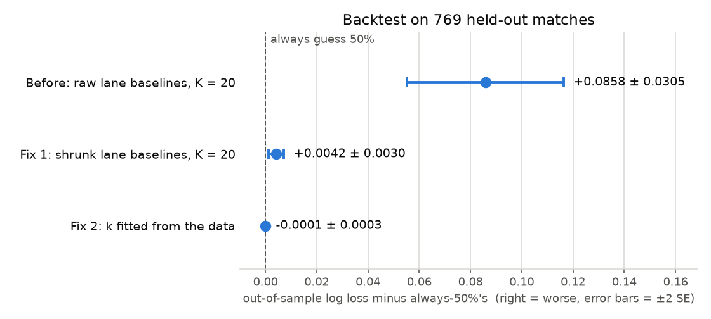

# LoL Matchup Analytics

**Personalized League of Legends matchup analytics, built on hierarchical empirical-Bayes shrinkage.**

**Live site:** [lyonstran.github.io/lol-matchup-analytics](https://lyonstran.github.io/lol-matchup-analytics/), refreshed with new matches every day.

Most stat trackers report raw win rates on tiny samples, like a "100% win rate" that is really one game. This tool builds population baselines from a corpus of ranked matches, then pulls every sparse win rate toward its baseline in proportion to how little data backs it. How hard to pull is not a number I picked: it is fitted from the data on every daily build. Every figure on the site comes with its sample size and a confidence label, because an honest "we don't know yet" beats a confident lie.

> The question this answers that op.gg can't: **"Do *I* actually beat the field in this matchup, and how sure can we be?"**

The statistics section also reports a result most trackers would not: tested on matches it has not seen, no matchup win rate built from this data predicts games better than a coin flip yet. The site is built to say so instead of hiding it.


---

## Population data vs. your data

The tool draws on two layers, and every panel in the UI is labeled by which one it uses:

| Panel | Data source | What it answers |
|-------|-------------|-----------------|
| **Matchup win rate** (top card, with confidence badge) | **Population**: every crawled ranked match | How this champion-vs-champion matchup goes *across all players*, shrunk for sample size |
| **Your history** (personal-vs-population card) | **Personal**: only matches containing the tracked player's PUUID | How *you specifically* perform in this matchup, and whether you beat the population |
| **Top items for [champion]** | **Population** | Champion-wide item win rates across all players, ranked by shrunk edge |
| **Items vs [opponent]** | **Population** | Item win rates for this champion *into this specific opponent*, across all players |
| **Shrinkage chart** | **Population** | Raw vs. corrected item win rates, visualizing the shrinkage |
| **AI coaching summary** | **Both** | A plain-language summary that combines your personal edge with population item trends, flagging small samples |

The design principle is that **population data provides the priors and personal data is the signal being estimated**. Your personal history is small and noisy on its own, and the population layer is what makes an honest personalized estimate possible. The "Your history" card is the only place your own games directly drive the numbers; everything else is population-wide context, and the AI summary is the one place the two are woven together.

---

## Why this is different

A player's personal history is *small data*. Over six games against a champion, a 4-2 record is statistically meaningless, essentially indistinguishable from a coin flip. Existing trackers report that 4-2 as "67%."

This project treats each sparse estimate as a **Bayesian update** on a population prior:

- Build champion-vs-champion matchup baselines from a corpus of ranked matches.
- For any specific (and usually sparse) matchup, shrink the raw win rate toward its baseline, weighted by sample size. A 1-game "100%" collapses to the baseline; a well-sampled rate moves much less.
- Apply the correction **hierarchically**: your personal cells shrink toward the *already-shrunk* population estimate, which shrinks toward the champion's *already-shrunk* rate in that lane, which shrinks toward 50%.
- **Fit the strength of each prior from the data** on every build, instead of choosing it by hand.
- **Test it out of sample** against the simplest possible forecast (always say 50%), and report the result honestly (see [Does it actually work?](#does-it-actually-work)).

---

## The statistics

The whole idea in one line: a win rate from a handful of games is mostly noise, so pull it toward a trustworthy average, and pull harder when there is less data.

### The problem

The obvious way to rate a matchup is wins divided by games. Call it $\hat{p} = w/n$. The trouble is how much that number bounces around when $n$ is small:

$$\mathrm{Var}(\hat{p}) = \frac{p(1-p)}{n}.$$

As $n$ shrinks, the variance blows up. At a single game the estimate is always exactly 0 or 1, maximally confident and completely useless. And most of the data looks like this: about half of all matchups have exactly one game behind them.


The same story from another angle. At low game counts the win rate is scattered everywhere, and it only settles down as games pile up:


### The fix: shrinkage

Treat each matchup's wins as a Binomial draw, $w \sim \mathrm{Binomial}(n, p)$, and put a Beta prior on the true win rate $p$, centered on a baseline $\mu$ we trust more:

$$p \sim \mathrm{Beta}(\alpha, \beta), \qquad \alpha = k\mu, \qquad \beta = k(1-\mu).$$

Here $\mu$ is where the prior is centered and $k$ is how strongly we believe it, measured in "pretend games." Because the Beta and Binomial fit together neatly, the updated (posterior) distribution is just another Beta:

$$p \mid w \sim \mathrm{Beta}(w + \alpha,\ n - w + \beta),$$

and its mean, the corrected win rate, is a weighted average of the data and the baseline:

$$\hat{p}_{\text{shrunk}} = \frac{w + k\mu}{n + k} = \frac{n}{n+k}\hat{p} + \frac{k}{n+k}\mu.$$

Read the two weights and the behavior is obvious. When $n$ is large next to $k$, the weight lands on the observed win rate. When $n$ is small, the weight lands on the baseline and the noisy number gets pulled home. There is no hard cutoff anywhere; the transition is smooth as games accumulate.

### Priors leaning on priors

The baselines are themselves shrunk, which is what makes the whole thing hierarchical. Your personal win rate in a matchup leans on the population's corrected win rate for that matchup, which leans on the champion's corrected rate in the lane, which leans on a coin flip:

$$\hat{p}_{\text{personal}} \leftarrow \hat{p}_{\text{population}} \leftarrow \hat{\mu}_{\text{lane}} \leftarrow 0.5.$$

Every arrow matters. If your personal matchup has three games and you lean it on a population cell that also has three games, you have propped one noisy number against another. The same goes one level up: the first version of this project shrunk matchups toward the champion's *raw* lane win rate, so a champion with one game in a lane got a baseline of 0% or 100%, and every matchup for that champion in that lane was pulled toward it. In November 2026, 138 of the 642 lane baselines sat at exactly 0% or 100%. The backtest below caught it.

### Picking how strong the prior should be

The one real choice is $k$, and it is read off the data, which is what makes this *empirical* Bayes.

The quick way is the method of moments: take well-sampled matchups, measure how spread out their win rates are, and solve $\hat{k} = \bar{p}(1-\bar{p})/s^2 - 1$. On this data that gives about 22. But it has a flaw. Even if every matchup were truly 50/50, finite samples would make the observed rates spread out anyway:

$$\mathrm{Var}(\hat{p}) = \underbrace{\mathrm{Var}(p)}_{\text{real differences}} + \underbrace{\mathrm{E}\left[\frac{p(1-p)}{n}\right]}_{\text{sampling noise}}.$$

The quick estimate counts the noise as real differences, so it believes matchups differ more than they do and shrinks too little.

The site instead fits $k$ by **maximum marginal likelihood**. Under the model, the probability of seeing $w$ wins in $n$ games, averaged over every possible true win rate, is the Beta-Binomial

$$P(w \mid k) = \binom{n}{w}\frac{\mathrm{B}(w + k\mu,\ n - w + k(1-\mu))}{\mathrm{B}(k\mu,\ k(1-\mu))},$$

where $\mathrm{B}$ is the Beta function. Multiply that over every cell, and pick the $k$ that makes the observed data most likely. This accounts for sampling noise automatically and uses every cell, with no "20 games or more" cut-off. The daily build does it twice: once for lane baselines (shrunk toward 0.5) and once for matchups (shrunk toward their lane baseline), trying values of $k$ from 1 to 1000.

**What it finds right now:** both fits land on the cap of 1000, and $k = 20$ fits far worse (its log-likelihood is about 160 lower for lane baselines and 80 lower for matchups). In plain words, at this data size the matches can't tell champions or matchups apart from a coin flip, so the site shows population win rates between about 48% and 52%. That is the honest answer, not a bug. As the daily crawl adds matches, real differences will start to stand out from the noise and the fitted $k$ will come down on its own, with no code change. Your personal layer still uses a fixed $k = 20$, so your own record is compared against that population.

### Does it actually work?

Shrinkage is only worth anything if it predicts games it has not seen. The backtest:

- Splits **by match**: 80% of matches train, the other 20% test, so no game is ever both learned from and tested on. A second run splits by time (oldest 80% train) and gives the same picture.
- Fits every estimator, including its $k$, on the training matches only.
- Scores the predicted win probability of every lane in the test matches with log loss, where lower is better:

$$\text{log loss} = -\frac{1}{N}\sum_i \left[ y_i \log \hat{p}_i + (1-y_i)\log(1-\hat{p}_i) \right].$$

- Compares each estimator with **always predicting 50%**, which scores $\ln 2 \approx 0.6931$. The error bars are ±2 standard errors computed from per-match totals, because the ten lanes of one match share a result and are not independent.



| Estimator (3,845 matches, 769 held out) | Log loss | Difference from always 50% (±2 SE) |
|---|---|---|
| Always 50% | 0.6931 | 0 |
| Raw matchup win rate | 2.9387 | +2.25 ± 0.21 |
| Site before the fix: raw lane baselines, $k = 20$ | 0.7789 | +0.086 ± 0.031 |
| Fix 1: shrunk lane baselines, $k = 20$ | 0.6973 | +0.004 ± 0.003 |
| **Fix 2 (live site): $k$ fitted from the data** | **0.6931** | **-0.0001 ± 0.0003** |

What this shows:

1. **Raw win rates are badly overconfident**, and shrinkage fixes that. This was the original backtest's headline (3.68 vs. 0.69), but it only compared shrinkage against raw rates, which is a low bar.
2. **The first version of the site did worse than a coin flip.** 55 of its 7,688 test predictions (0.7%) were below 5% or above 95%, and they caused 92% of the excess loss. All of them came from the unshrunk lane baselines.
3. **With every prior shrunk and $k$ fitted, the site ties a coin flip.** It never does worse, and at this data size nothing does better.

So the honest claim is: shrinkage stops the tool from reporting overconfident numbers built on tiny samples, and with $k$ fitted from the data it is never worse than a coin flip. It is not yet a forecast that beats one. That needs more data, which the daily crawl keeps adding, and the backtest in the notebook can be rerun at any time to check.

**Corpus:** about 3,800 ranked matches as of November 2026 and growing daily (the site footer shows the live count and the fitted $k$), giving roughly 12,900 matchup cells (one champion against another in a given lane), plus a personal layer of my own ranked games.

### Known limitations

- **Item win rates are associations, not effects.** Items are counted from each player's final inventory, and longer or winning games end with more finished items, so item edges are likely inflated by game length.
- **The personal layer uses a fixed $k = 20$.** There are too few personal cells to fit it the same way yet.

---

## Architecture


Everything on the left runs once a day in GitHub Actions. The site itself is just files: there is no server and no database to keep running.

**How it fits together, step by step:**

1. **Collect the data.** A crawler pulls ranked matches from Riot's API. Riot enforces strict rate limits, so it throttles itself and walks outward from one player to the people in their games, then the people in *their* games, snowballing a large, varied corpus. Every raw match lands in S3 exactly as Riot returned it and is never modified, so the original data is always there to reprocess.

2. **Count, fit, and correct.** A plain Python build step reads every match once and counts games and wins for each champion in each lane, each champion-vs-champion matchup, each item, and each of my own games. It fits the prior strength $k$ for lane baselines and matchups from those counts, then applies the shrinkage, turning noisy small-sample win rates into honest estimates.

3. **Publish precomputed answers.** The build writes one small JSON file per champion (a few MB in total). The React frontend loads only the file it needs, so every lookup is instant. Nothing is computed or fetched from Riot when someone uses the site.

4. **Explain it in plain English (optional).** The site can send the computed numbers to Claude, which writes a short coaching summary. Claude only ever sees the real statistics and is told to flag numbers based on too few games. This runs in the browser with the visitor's own Anthropic API key, so the site still needs no server.

In short: **raw matches in S3, then a daily Python build that counts, fits, and shrinks, then static JSON and a React site on GitHub Pages**, with an optional AI layer that turns the stats into advice.

### Why it is built this way

The first version (tag `v1-render`) used AWS Athena for SQL over S3, a Postgres feature store on Neon, a FastAPI service and a static site on Render, all wired together with Docker Compose. It worked, but every number it served changes at most once a day, the data the site needs is a few MB, and it has one user. The v2 rewrite precomputes everything in one daily job and serves plain files instead. That removed four hosted services, the cold starts of a free-tier API, and an Athena table that only existed in the AWS console, while producing the same numbers (checked value by value against the old API before switching over).

---

## The pipeline

| Stage | What it does | Key engineering |
|-------|--------------|-----------------|
| **Ingestion** | Crawls ranked matches into an immutable S3 raw layer | Dual sliding-window rate limiter (20/s + 100/2min), 429 backoff, dedup against a local copy, breadth-first player-graph crawl seeded from a permanent PUUID |
| **Storage** | Raw match JSON, never mutated or re-fetched | S3 with a least-privilege IAM key (no delete permission, enforcing immutability) |
| **Processing** | Matchup matrix, champion/lane baselines, item stats, matchup-specific items, personal record | One pass over the raw JSON in plain Python; champions keyed by numeric ID so renamed or oddly spelled champions always match |
| **Modeling** | Empirical-Bayes Beta-Binomial shrinkage | Hierarchical (personal, then population, then lane baseline, then 0.5); prior strength fitted by Beta-Binomial maximum likelihood on every build |
| **Validation** | Out-of-sample backtest in the notebook | Match-level split, coin-flip baseline, per-match standard errors, one row per version of the site |
| **Publishing** | Precomputed estimates as static JSON | Daily GitHub Actions job: crawl, build, then deploy to GitHub Pages; raw matches cached between runs |
| **UI** | Matchup tool foregrounding confidence | React (Vite); sample size and confidence badges, item icons, a raw-vs-shrunk chart (Recharts), and grounded AI coaching summaries |

---

## Tech stack

**Data & cloud:** AWS S3, Riot Games API (production key), Data Dragon

**Pipeline:** Python, httpx, boto3, uv

**Modeling:** empirical-Bayes Beta-Binomial shrinkage with the prior strength fitted by maximum marginal likelihood (plain Python in the build; pandas, numpy and matplotlib in the notebook)

**AI:** Anthropic API (Claude) for grounded natural-language coaching summaries

**Frontend:** React, Vite, Recharts

**Automation & hosting:** GitHub Actions (daily refresh), GitHub Pages

---

## Running locally

**Prerequisites:** [uv](https://docs.astral.sh/uv/), Node.js, an AWS account with an S3 bucket, a Riot API key, and (optional, for coaching summaries) an Anthropic API key.

```bash
# 1. Clone and configure
git clone https://github.com/lyonstran/lol-matchup-analytics.git
cd lol-matchup-analytics
cp .env.example .env          # fill in RIOT_API_KEY, AWS keys, S3_BUCKET, MY_PUUID
uv sync

# 2. Get the data
uv run python pipeline/sync_raw.py         # download raw matches from S3 into data/raw/matches
uv run python pipeline/crawl.py            # optional: crawl new matches (rate-limited)
uv run python pipeline/crawl_personal.py   # optional: crawl your own new matches

# 3. Build the site data
uv run python pipeline/build.py            # writes web/public/data/*.json

# 4. Run the site
cd web && npm install && npm run dev       # http://localhost:5173

# Optional: the notebook (backtest included) and the README figures
uv run jupyter lab                         # then open notebooks/shrinkage.ipynb and Run All
uv run python notebooks/generate_figures.py  # rewrites docs/figures/ and prints the numbers quoted here
```

`uv run python pipeline/lookup_puuid.py "<game name>" "<tag>"` prints the PUUID for a Riot ID.

---

## Project structure

```
lol-matchup-analytics/
├── pipeline/                   # all the Python the daily build runs
│   ├── crawl.py                # rate-limited breadth-first crawler, Riot to S3
│   ├── crawl_personal.py       # pages through my own ranked history
│   ├── sync_raw.py             # S3 to a local copy in data/raw/matches
│   ├── build.py                # counts, fits k, shrinks, writes the site's JSON
│   ├── shrinkage.py            # the Beta-Binomial estimator and the k fit
│   ├── riot_client.py          # Riot API client (retries, 429 handling)
│   ├── rate_limiter.py         # multi-window sliding rate limiter
│   └── s3.py, ddragon.py, config.py, lookup_puuid.py
├── notebooks/
│   ├── shrinkage.ipynb         # walkthrough: shrinkage, fitting k, backtest, personal layer, items
│   ├── backtest.py             # the match-level backtest (used by the notebook and the figures)
│   ├── notebook_data.py        # loads the raw matches with the build's own counting code
│   └── generate_figures.py     # the figures in this README
├── web/                        # React (Vite) frontend
├── docs/figures/               # figures used in this README
└── .github/workflows/          # daily refresh and deploy
```

---

## Author

**Lyons Tran**, Statistics @ UIUC (Minor in Data Science)
[Portfolio](https://lyonstran.github.io/) · [LinkedIn](https://www.linkedin.com/in/lyonstranuiuc/)

---

## Resources & further reading

The statistical methods in this project rest on standard Bayesian estimation theory. The two texts below were the primary references; specific sections are noted since they map directly onto the model.

### Statistics & Bayesian inference

- **Hogg, R. V., McKean, J. W. & Craig, A. T.**, *Introduction to Mathematical Statistics*, 7th ed. (Pearson).
  Course text for Bayesian inference. The shrinkage estimator used here is exactly the Bayesian point estimate derived in **11.2.2 (Bayesian Point Estimation, p. 612)**: a Beta prior on a Binomial proportion yields a Beta posterior, and the posterior mean $(\alpha + y)/(\alpha + \beta + n)$ *is* the shrunk win-rate estimate. Conjugacy of the Beta-Binomial family is formalized in **11.3 (p. 619)**, and the empirical-Bayes extension, where the prior's parameters are estimated from the marginal distribution of the data, is **11.5.1 (Empirical Bayes, p. 636)**. That is the basis for fitting $k$ by Beta-Binomial marginal likelihood.

- **Hogg, R. V., Tanis, E. A. & Zimmerman, D. L.**, *Probability and Statistical Inference*, 10th ed. (Pearson).
  Probability foundations and estimation. The Binomial distribution (**2.4, p. 63**) is the model for match outcomes; **Chapter 6 (Point Estimation, p. 233)** covers maximum likelihood and method-of-moments estimation (**p. 264**; the quick estimate of $k$ shown in the notebook for contrast); and **6.8 (Bayesian Estimation, p. 298)** develops the Beta-Binomial posterior directly.

### Documentation & tools

- [Riot Games API documentation](https://developer.riotgames.com/): Match-V5, Account-V1, and rate-limit policy.
- [uv documentation](https://docs.astral.sh/uv/): Python environments and lockfile.
- [GitHub Actions](https://docs.github.com/en/actions) and [GitHub Pages](https://docs.github.com/en/pages): the daily refresh and hosting.

### Acknowledgments

- **Claude (Anthropic)** was used as a research and debugging aid throughout development, as well as talking through the statistical approach, working through implementation issues, and reviewing design decisions. All modeling choices, code, and the final implementation are my own.

---
